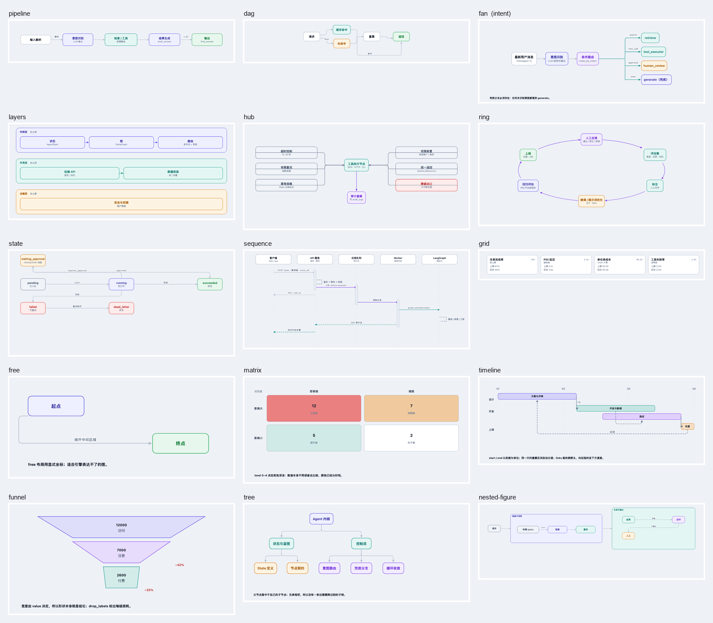

# docforge

**物料进，单文件 HTML 出。图示是内联 SVG，几何由校验器自动检查。**

[English](README.md) · MIT 许可 · Python ≥ 3.9，只用标准库

docforge 把一个 Markdown 物料加若干 JSON 图示规格，编译成一个自包含的 `.html`：
样式内联、图示是内联 SVG、没有外部请求、双击就能看、直接可打印、可换主题。

它真正解决的不是"生成网页"，而是**生成完能自动证明图没画错**。
每个绘图原语在画的同时记录自己的包围盒，校验器据此报出文字溢出、盒子重叠、
连线穿过无关节点、标签压字、元素出界。你不必靠眼睛找问题。

```
物料 markdown ──┐
                ├──> markdown.parse ──> Doc ──┐
图示 JSON ──────┘                             ├──> document.render ──> index.html
                └──> specs.render ──> SVG ────┘
                          │
                          └──> validate.check_scene ──> 几何结论（0/1 退出码）
```

---

## 快速开始

不需要安装任何东西。只要有 Python ≥ 3.9（只用标准库）。

```bash
cd <这个目录>

# 1. 起一份物料
python3 -m docforge.cli init ./out --template doc

# 2. 改 out/material.md 和 out/figures/*.json
# 3. 先只校验 —— 这一步干净了再往下
python3 -m docforge.cli check ./out/material.md

# 4. 生成
python3 -m docforge.cli build ./out/material.md -o ./out/index.html
```

`bin/docforge` 是个等价的一行封装，可以加进 `PATH`：

```bash
export PATH="$PWD/bin:$PATH"
docforge skill-info
```

---

## 界面

### 一、图块接口（物料内联）

````markdown
```figure arch
@figures/arch.json          ← 引用文件
```

```figure quick
{ "layout": "pipeline", "nodes": [{"id":"a","title":"A"}], "edges": [] }
```
````

### 二、声明式图示规格

一个 JSON 对象。**引擎负责摆位，规格负责内容** —— 你不需要算坐标。

```json
{
  "id": "flow", "layout": "pipeline", "title": "主流程",
  "nodes": [
    {"id": "in",  "title": "输入解析", "sub": ["raw input"]},
    {"id": "out", "title": "输出", "sub": ["final_answer"], "kind": "green"}
  ],
  "edges": [{"from": "in", "to": "out", "label": "解析"}]
}
```



十四个布局引擎。关系型：`pipeline` `dag` `fan` `layers` `hub` `ring` `sequence` `state` `grid` `free`；
数据型：`matrix`（格子网格，深浅连续可调）、`timeline`（沿一根轴的区间，重叠自动分道，可画依赖箭头）、
`funnel`（按数值收窄的阶段）；层级：`tree`。深色模式同一组见 [`docs/images/engines-dark.png`](docs/images/engines-dark.png)。


每个的用途和参数：

```bash
python3 -m docforge.cli layouts
```

宽度是从文字算出来的（中文按 1.0 em，拉丁按 0.55 em），所以不要手写宽度。
需要精调时，节点可以给 `x`/`y`/`width`/`height` 覆盖自动摆位；实在特殊就上 `free`，
用 `connectors[].pts` 完全手动布线。

### 三、Python API

```python
from docforge import specs, document, markdown
from docforge.theme import Theme, document_css

theme = Theme.load("paper")
doc = markdown.parse_file("out/material.md")
figures = {ref.id: specs.render_svg(specs.load(f"out/figures/{ref.id}.json"))
           for ref in doc.figures}
html = document.render(doc, figures, theme, numbering="auto")
```

### 四、命令行

| 命令 | 作用 |
|---|---|
| `docforge build <物料>` | 物料 → 单文件 HTML |
| `docforge fig <图示>` | 单张图 → SVG（`--png` 顺带出 PNG） |
| `docforge check <目标…>` | 只校验，不产出；可传图示或物料 |
| `docforge init <目录>` | 生成起始物料（`--template doc/report/course`） |
| `docforge themes` | 列出主题 |
| `docforge layouts` | 列出布局引擎 |
| `docforge shot <html> <png>` | 无头浏览器截图（可选） |
| `docforge examples` | 列出随包示例 |
| `docforge skill-info` | 机器可读的能力描述 |

`check` 与 `build` 都支持 `--format json` 和 `--fail-on error|warning|none`。

### 五、能力自描述（给其他 agent / plugin 用）

```bash
python3 -m docforge.cli skill-info --json     # 布局、主题、命令、退出码、错误码
python3 -m docforge.cli check x.json --format json
```

退出码：`0` 干净 · `1` 校验未通过 · `2` 用法/IO 错 · `3` 内部错。

---

## 校验

这是 docforge 和"模板拼网页"的根本区别。`check` 和 `build` 都会跑校验。

**错误**（必须改）：

| code | 含义 |
|---|---|
| `text-overflow` | 文字比盒子宽 |
| `box-overlap` | 两个盒子相交 |
| `edge-through` | 连线穿过无关节点 |
| `label-collision` | 标签压在盒子、另一个标签，或分层带的表头上 |
| `edge-over-label` | 连线从**别人的**标签文字上穿过 |
| `out-of-canvas` | 元素出界 |
| `degenerate-edge` | 连线长度为 0 |

**警告**（需要判断）：`edge-crossing`、`isolated-node`、`band-overlap`、
`short-connector`、`connector-detached`、`edge-overlap`、`label-clearance`、`no-figures`。

节点确实该独立时，**声明**而不是压制：

```json
"options": {"allow_isolated": ["security"]}
```

文档级还有 `unresolved-figure`、`tag-imbalance`、`duplicate-id`、`dangling-anchor`、
`figure-missing`、`figure-spec-invalid`、`figure-render-failed` 等，全部是错误。

```bash
python3 -m docforge.cli check out/material.md --format json --fail-on warning
```

### 为什么这能成立

`Scene` 在发射 SVG 的同时记录每个元素的 `Item(kind, bbox, inner, text_boxes, pts, endpoints)`。
校验器读这份记录，用**布局自己用的同一套文字度量**去比对，
所以它检查的是"布局模型内部是否自洽"，不是像素级猜测。

代价要说清楚：拉丁字宽按 0.55 em 估算，校验器留 2px 容差。
极端字体下仍可能差一点。CJK 的 1.0 em 估算足够准。

---

## 主题

主题是 JSON，`light` / `dark` 两份 token 必须键名一致（`Theme.missing()` 会验证）。
**文档里的 SVG 没有写死任何颜色**，全部走 CSS 变量，所以换主题时图与正文一起换。

| 主题 | 观感 |
|---|---|
| `paper` | 浅色纸面 + 靛蓝（默认） |
| `midnight` | 冷色深底 + 青色 |
| `contrast` | 高对比，面向无障碍与打印 |

加自己的：照 `themes/paper.json` 复制改色值。物料里 `mode: dark` 可以指定默认明暗。

---

## 截图（可选）

自动校验**不需要浏览器**。只有想人眼看渲染结果时才需要 Chromium 系浏览器。

```bash
python3 -m docforge.cli shot out/index.html /tmp/shot.png --width 1440 --height 2400
```

找不到浏览器时会明确报错并给出 `DOCFORGE_BROWSER`，不会假装成功。
注意截图**只能从页面顶部拍**；要看后面的章节，把该章节单独成页再拍。

无头 Chromium 很吃内存，同时开几个会把彼此拖慢到超时，所以 `shot()` 用一把
进程间文件锁**把并发截图串起来**（最多等 180 秒）。多个 agent 同时截图不会
互相踩踏。

---

## 测试

```bash
sh tools/test.sh                   # 全部单测 + 端到端（POSIX sh，不是 python）
python3 -m unittest discover -s tests -t . -v
```

测试分五类：

- **几何与度量**（`test_geom` / `test_text`）—— 线段相交、矩形关系、CJK 宽度估算。这是校验器的地基。
- **场景记录**（`test_scene`）—— 每个原语是否登记了正确的几何与 `lines`。
- **校验器**（`test_validate` / `test_overlap`）—— 每个错误码都要有**触发用例**和**临界不触发用例**；连线交叉的反例守卫（同源扇出、T 形接头）单独测。
- **布局引擎**（`test_layouts`）—— 每个引擎的摆位性质（顺序、不重叠、落在给定椭圆上、菱形同列），且**每个引擎的输出必须零错误**。
- **端到端**（`test_e2e`）—— 物料 → HTML 全流程、构建确定性、坏物料必须报错。

---

## 目录

```
docforge/
  SKILL.md            agent 面向的使用说明（部署为 skill 时的入口）
  INTERFACE.md        冻结的接口契约：全部签名与数据结构
  README.md           本文件
  docforge/           可 import 的 Python 包
    text.py           中英混排宽度度量
    geom.py           Rect / 线段 / 圆角折线 / 弧线采样
    scene.py          Scene：画图 + 记录几何
    layouts.py        十四个布局引擎（产出 Plan，不直接画）
    specs.py          图示规格：加载 / 校验 / 渲染
    validate.py       几何与文档校验
    theme.py          主题 token → CSS
    highlight.py      代码块分语言着色（tok-* 标注，纯标准库）
    markdown.py       物料解析
    document.py       文档装配 → 单文件 HTML
    render.py         可选的无头浏览器截图
    cli.py            命令行
  assets/             base.css（结构）+ code.css（代码块外观）+ svg.css（图元样式，唯一来源）
  themes/             paper / midnight / contrast
  templates/          doc / report / course 三套起始物料
  examples/           随包示例
  tests/              单测与端到端
  tools/              测试与打包脚本
```

---

## 扩展

**加一个布局引擎**：在 `layouts.py` 里写一个返回 `Plan` 的函数，用 `@layout("name")`
注册，在 `cli.LAYOUT_DOC` 补一句说明。`Plan` 只描述"谁在哪、谁连谁、哪个容器包住谁"，
画图由 `render()` 统一做 —— 所以新引擎自动获得校验、主题、独立 SVG 导出能力。

**加一条校验规则**：在 `validate.py` 里加一个 `_check_xxx(scene, ..., out)`，
往 `out` 里塞 `Finding`，然后在 `check_scene` 里调用。
记得同时写**触发用例**和**不触发的临界用例**。

细节见 `INTERFACE.md`。

---

## 许可

MIT，见 [LICENSE](LICENSE)。
